# TP3 – Optimización de Modelos de Machine Learning

**Materia:** 72.75 Aprendizaje Automático (2026 Q2)

**Problema:** predecir si una reserva de infraestructura GPU va a ser cancelada antes de ejecutarse (`canceled_job`), con el dataset `gpu_resource_reservations.csv`.

Este README es el informe del trabajo. Sigue el orden de la consigna ([`TP3. Optimización de Modelos de ML..pdf`](TP3.%20Optimizaci%C3%B3n%20de%20Modelos%20de%20ML..pdf)) y funciona también como guía paso a paso: cada sección dice qué script se corrió, qué decisiones se tomaron y por qué, y qué resultados salieron. Cada paso se commiteó por separado, así que el historial de git sigue el mismo orden.

---

## Índice

- [Paso 0 – Estructura del proyecto y cómo reproducir](#paso-0--estructura-del-proyecto-y-cómo-reproducir)
- [Paso 1 – Preprocesamiento y análisis exploratorio](#paso-1--preprocesamiento-y-análisis-exploratorio)
- [Paso 2 – Model-centered ML: baseline, validación cruzada y métricas](#paso-2--model-centered-ml-baseline-validación-cruzada-y-métricas)
- [Paso 3 – Error analysis y enfoque data-centered](#paso-3--error-analysis-y-enfoque-data-centered)

---

## Paso 0 – Estructura del proyecto y cómo reproducir

```
.
├── gpu_resource_reservations.csv   # dataset original
├── requirements.txt
├── tp3/                            # código reutilizable
│   ├── config.py                   # rutas, semilla, grupos de columnas, columnas con leakage
│   ├── data.py                     # carga, limpieza determinística, split train/test agrupado
│   ├── preprocessing.py            # ColumnTransformer (imputación, one-hot, escalado)
│   ├── evaluation.py               # k-fold CV, métricas, análisis por cohortes
│   └── plotting.py                 # estilo común de figuras
├── steps/                          # un script por paso del TP (se corren en orden)
├── reports/figures/                # figuras generadas (se muestran en este README)
├── reports/tables/                 # tablas de resultados (.csv y .md)
├── models/                         # modelo final serializado
└── predictor/                      # función predictora para entregar
```

**Instalación**

```bash
pip install -r requirements.txt
```

**Ejecución:** cada paso es un script independiente que lee el CSV, regenera sus figuras y tablas y las guarda en `reports/`:

```bash
python steps/01_eda.py
```

(los comandos de los pasos siguientes se indican en cada sección).

**Reproducibilidad:** semilla fija (`RANDOM_STATE = 42`) en splits y modelos. Todos los scripts toman los datos de `tp3.data.get_data()`, así el conjunto de test es siempre el mismo y no se usa en ningún paso salvo la evaluación final (Paso 5).

---

## Paso 1 – Preprocesamiento y análisis exploratorio

**Script:** `python steps/01_eda.py` → tablas `reports/tables/01_*` y figuras `reports/figures/01_*`.

### 1.1 Primer vistazo al dataset

| chequeo | valor |
|:--|:--|
| filas × columnas | 47 842 × 34 (las 29 de la consigna + 5 extra: `execution_status`, `execution_status_date`, `total_processes`, `total_gpu_hours`, `high_value_client`) |
| tasa de cancelación | **41.7 %**: desbalance moderado, no extremo |
| período | ejecuciones de julio 2015 a agosto 2017 |
| filas idénticas en todas las features | **15 936 (33 %)**. El 40.6 % de las filas pertenece a algún grupo de duplicados |
| cancelación en filas duplicadas vs únicas | **61.2 % vs 28.4 %** |
| grupos de duplicados con etiquetas contradictorias | 79 de 3 499 |

Valores faltantes:

| columna | faltantes | interpretación |
|:--|--:|:--|
| `organization_id` | 45 540 (95.2 %) | la reserva **no** está asociada a una organización |
| `orchestration_agent_id` | 5 035 (10.5 %) | la reserva no pasó por un agente de orquestación |
| `client_region` | 20 (0.04 %) | región desconocida |
| `num_auxiliary_processes` | 1 | faltante puntual |

### 1.2 Data leakage: columnas que se eliminan

Antes de modelar revisamos qué columnas no van a estar disponibles al momento de predecir o que codifican el target:

| columna | evidencia | decisión |
|:--|:--|:--|
| `execution_status` | es una re-codificación exacta del target: `canceled`/`no_show` ⇒ 1 y `completed` ⇒ 0 en el 100 % de los casos (tabla `01_leakage_execution_status`) | **eliminar** |
| `execution_status_date` | en las reservas no canceladas es la fecha de finalización (0 a 4 días *después* del inicio); en las canceladas es la fecha de cancelación (mediana 53 días *antes* del inicio). Separa las clases casi perfectamente y no se conoce al reservar | **eliminar** |

El resto de las columnas son las de la consigna y se usan como features. Hay dos casos que conviene mencionar:

* `assigned_gpu_type` y `queue_wait_time` describen la asignación final de recursos. En un sistema real podrían conocerse recién cerca de la ejecución, lo que sería *leakage temporal*. Cuando la GPU asignada difiere de la reservada, la tasa de cancelación cae a **6 %** (probablemente porque el cambio se registra al ejecutar). Como la consigna las define como variables del problema y la función predictora va a recibir esas columnas, **se mantienen**, pero hay que tenerlo en cuenta al interpretar los resultados.
* `total_processes` y `total_gpu_hours` son exactamente la suma de sus componentes (verificado) y `high_value_client` está asociado al costo por hora (4.55 vs 7.56 USD/h). Son columnas derivadas sin información nueva, pero no tienen leakage. Se mantienen.

### 1.3 Split train/test (antes de cualquier ajuste)

* **Hold-out 80/20** estratificado por el target: 38 274 filas de train y 9 568 de test, ambos con 41.7 % de cancelación.
* **Agrupado por duplicados (`StratifiedGroupKFold`):** cada combinación única de features recibe un `group id` y todas las copias de un grupo caen del mismo lado del split. Sin esto, un tercio del test serían filas que ya están en train, el modelo "las recordaría" y la métrica estimada estaría inflada. Verificamos que hay **0 combinaciones de features compartidas** entre train y test.
* Todo el EDA que sigue y todos los pasos de modelado usan **sólo train**. El test se usa una única vez, en el Paso 5.

### 1.4 Limpieza y tratamiento de faltantes

La limpieza se separa en dos tipos, según si aprende algo de los datos o no:

1. **Determinística, fila a fila (`tp3.data.clean`):** no aprende nada de los datos, así que puede aplicarse antes del split y también en inferencia (la usa la función predictora).
   * elimina `execution_status` y `execution_status_date`;
   * categóricas: `NaN` → `"missing"`;
   * IDs de agente y organización: se convierten a **categoría** (son identificadores, no magnitudes: el agente 240 no es "más" que el 9). `NaN` → `"none"`, que significa "sin agente" o "sin organización". Eso en sí es informativo: sin agente se cancela 33 % y con organización 24 %, contra 43 % en el resto.
2. **Aprendida, dentro del `Pipeline` de sklearn (`tp3.preprocessing`):** se ajusta sólo con el fold de entrenamiento en cada iteración de CV, así no hay leakage entre folds.
   * numéricas: `SimpleImputer(median)` (cubre el único faltante de `num_auxiliary_processes`) + `StandardScaler`;
   * categóricas: `OneHotEncoder` con `min_frequency`. Las categorías raras (< 20 casos; < 50 en `client_region`, que tiene 149 países; < 100 en los IDs) se agrupan en una categoría `infrequent`. Así se evitan columnas casi vacías y se resuelven las categorías no vistas en test (`handle_unknown="infrequent_if_exist"`).

**Anomalías detectadas** (tabla `01_anomalias`):

| anomalía | filas | % cancelación | decisión |
|:--|--:|--:|:--|
| `total_processes == 0` (workload sin procesos) | 108 | 10 % | se mantienen. Son inconsistentes, pero tienen un patrón propio (casi no cancelan) y pueden aparecer en datos nuevos. En el Paso 4 se evalúa sacarlas del entrenamiento |
| `total_gpu_hours == 0` | 193 | 6 % | ídem |
| `estimated_cost_per_hour == 0` | 727 | 11 % | se mantienen: reservas sin costo (cortesía o contratos especiales) |
| `estimated_cost_per_hour > 20` | 2 | – | outlier extremo (270 USD/h contra una mediana de 5). No afecta a los árboles y con `StandardScaler` es un único punto, así que se mantiene |
| `client_type` / `request_channel` = `"unknown"` | 1 | – | queda absorbida por la categoría `infrequent` del one-hot |

**Duplicados.** No se eliminan, porque representan reservas reales cargadas en lote (reservas grupales) y su tasa de cancelación es muy distinta (61 % vs 28 %). Eliminarlos cambiaría la distribución que vamos a encontrar en producción. Lo que sí se hace es controlar su efecto en la evaluación con el split agrupado (1.3). En el Paso 4 se prueba entrenar sin duplicados como estrategia data-centered.

### 1.5 Análisis exploratorio

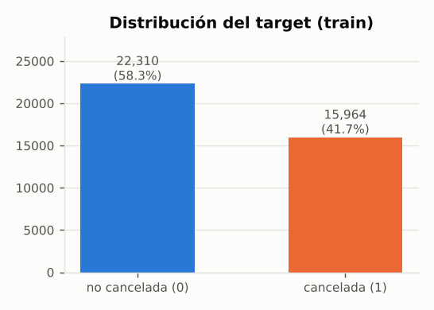

**Cohortes y subgrupos.** Tasa de cancelación por valor de cada variable categórica. La línea punteada es la tasa global.

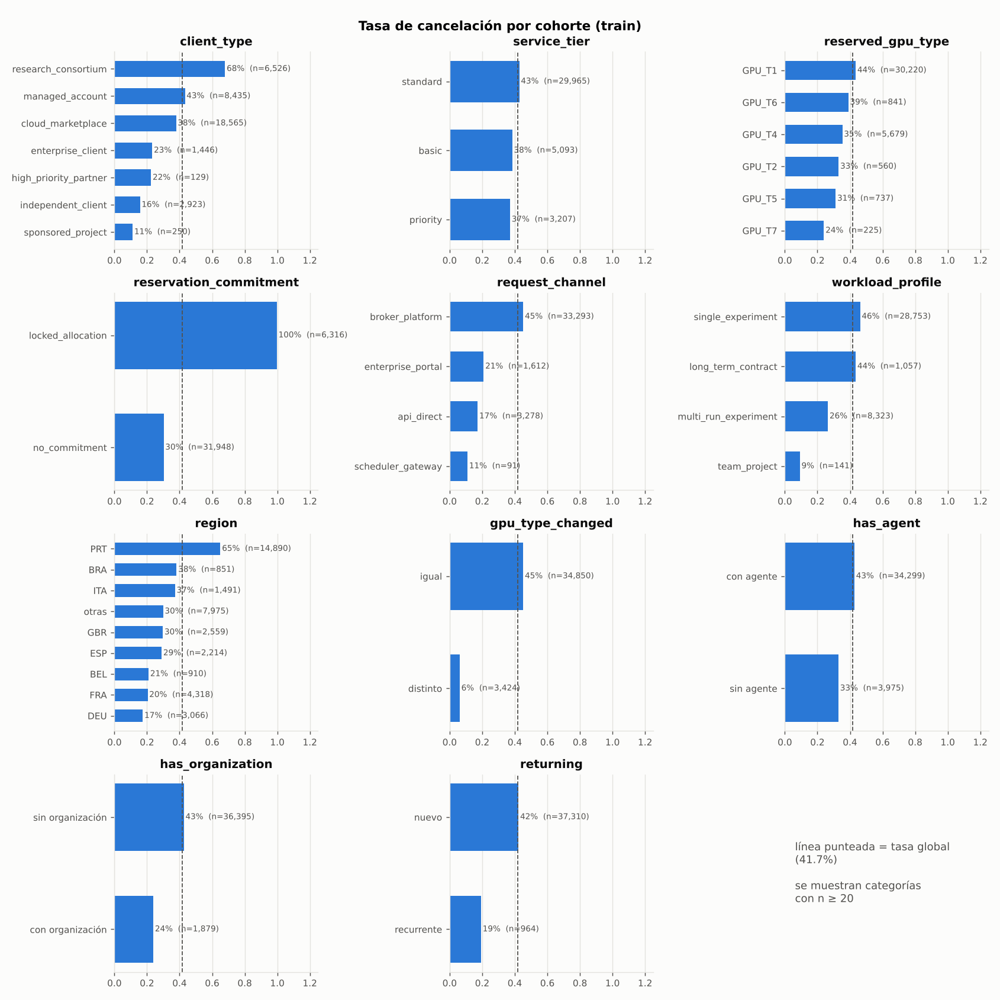

* **`reservation_commitment` es la variable más fuerte:** `locked_allocation` se cancela el **~100 %** de las veces (6 316 reservas de train) y `no_commitment` el 30 %. Se esperaría que un compromiso firme baje la cancelación, pero acá pasa lo contrario. La tabla cruzada con `client_type` sugiere una explicación: el `locked_allocation` se concentra en `research_consortium` (3 553 reservas, 99.9 % canceladas) y `managed_account` (2 523, 100 %), que son bloques reservados en lote y cancelados en masa. Esto explica también buena parte de los duplicados.
* **`client_type`:** `research_consortium` cancela 68 %, `managed_account` 43 % y `cloud_marketplace` 38 %. Los clientes directos (`independent_client` 16 %, `enterprise_client` 23 %) cancelan mucho menos.
* **`service_tier`** y **`reserved_gpu_type`** discriminan poco por sí solos: 37–43 % y 24–44 % respectivamente.
* **`client_region`:** PRT (39 % de train) cancela **65 %** y el resto de Europa entre 17 y 30 %.
* **`request_channel`:** `broker_platform` cancela 45 % y el canal directo/API 17–21 %.
* **GPU asignada ≠ reservada:** 6 % de cancelación (ver la advertencia sobre leakage temporal en 1.2).

Cruce `client_type` × `reservation_commitment` (tasa de cancelación / n en train):

| client_type | locked_allocation | no_commitment |
|:--|--:|--:|
| cloud_marketplace | 0.85 (13) | 0.38 (18 546) |
| managed_account | 1.00 (2 523) | 0.19 (5 910) |
| research_consortium | 1.00 (3 553) | 0.30 (2 973) |
| enterprise_client | 0.95 (215) | 0.11 (1 229) |
| independent_client | 0.92 (12) | 0.15 (2 911) |

Una vez que se controla por `reservation_commitment`, el ranking de cancelación entre tipos de cliente cambia: **dentro de `no_commitment`, `cloud_marketplace` es el que más cancela (38 %)**. Esto anticipa dónde van a estar los errores difíciles: reservas sin compromiso hechas por marketplace.

**Variables numéricas** (tasa de cancelación por decil o por valor):

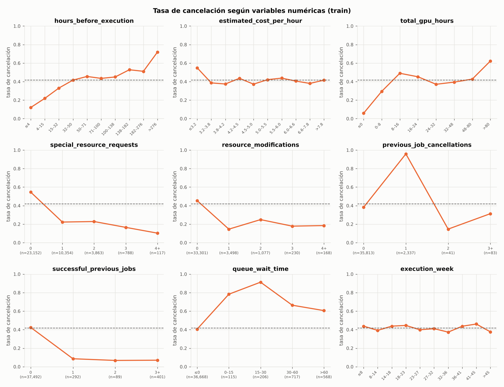

* `hours_before_execution` (anticipación) es la numérica más informativa. La cancelación crece de 12 % (≤ 4 h) a 72 % (> 276 h): cuanto más lejos está la ejecución, más probable es que el cliente cancele.
* `special_resource_requests`: 55 % de cancelación sin pedidos especiales contra ~20 % con al menos uno. Pedir recursos especiales indica compromiso con el workload.
* `previous_job_cancellations = 1` → 96 % de cancelación. `successful_previous_jobs ≥ 1` → < 10 %. El historial del cliente es muy predictivo, pero sólo el 6 % de las filas tiene historial.
* `queue_wait_time > 0` → 60–90 % de cancelación, aunque afecta sólo al 4 % de las reservas.
* `resource_modifications ≥ 1` → 15–25 % de cancelación.
* `estimated_cost_per_hour` y `execution_week` tienen poca relación marginal con el target. Pueden aportar en interacción con otras variables.

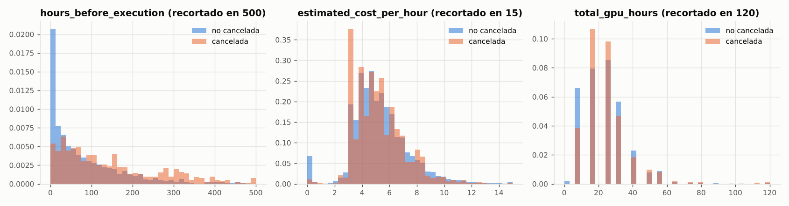

**Correlaciones** (Spearman):

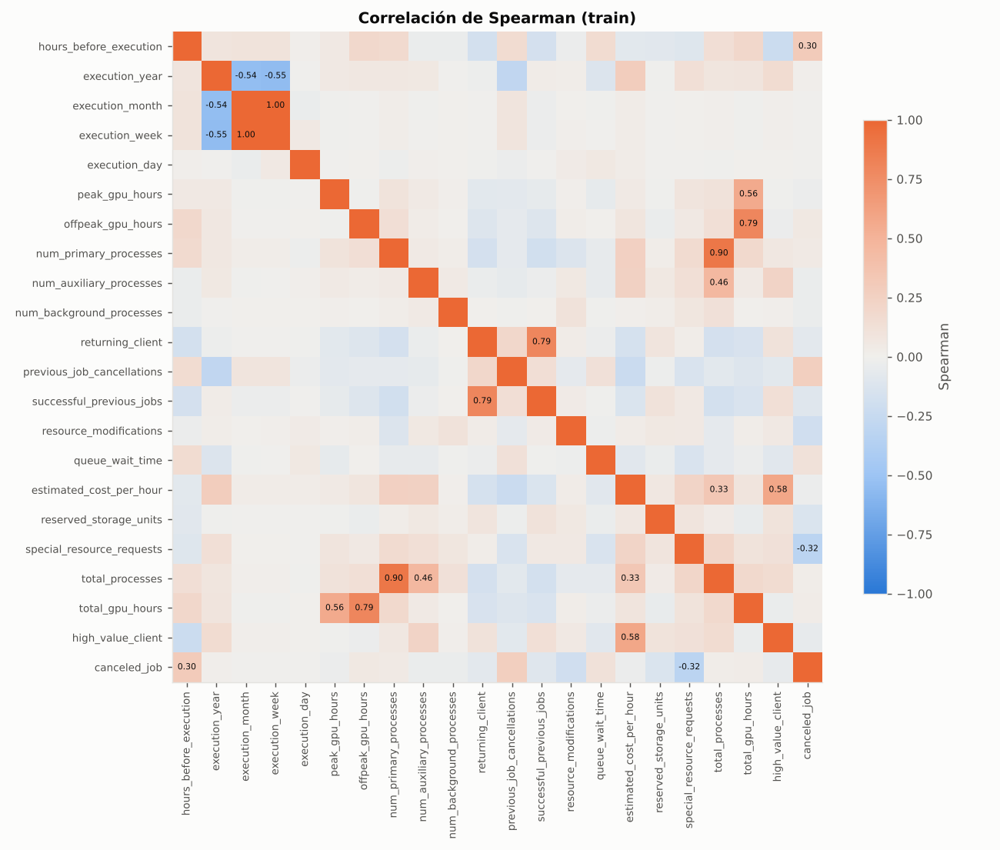

Las variables más asociadas al target son `special_resource_requests` (−0.32), `hours_before_execution` (+0.30), `previous_job_cancellations` (+0.27) y `resource_modifications` (−0.19). Hay redundancias esperables: `execution_month` y `execution_week` (ρ = 1.00), `total_*` con sus componentes y `returning_client` con `successful_previous_jobs` (0.79). Para modelos lineales con regularización y para árboles esto no es un problema grave. En el Paso 4 se evalúa la selección de variables.

**Temporal:**

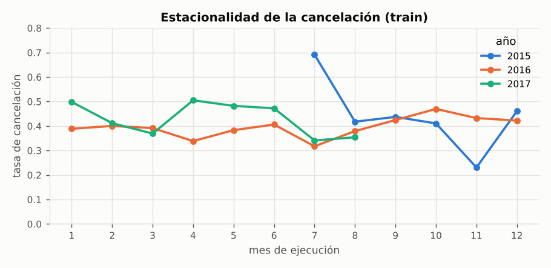

La tasa de cancelación varía entre 30 % y 50 % según el mes, sin una estacionalidad muy marcada. Julio de 2015 (el comienzo del período) es atípico (69 %). Como el test se toma al azar del mismo período, `execution_year` se puede usar como feature. Si el objetivo fuera predecir años futuros habría que hacer un split temporal.

### 1.6 Conclusiones del EDA que guían los pasos siguientes

1. Se eliminan 2 columnas con leakage y el split es **agrupado por duplicados** para que la evaluación sea honesta.
2. El problema tiene señal fuerte en pocas variables: compromiso, tipo de cliente, región, anticipación, pedidos especiales e historial. Varias de esas relaciones son **no lineales y con interacciones** (por ejemplo `client_type × commitment`), así que se espera que los modelos basados en árboles superen a los lineales.
3. Las cohortes `client_type`, `service_tier` y `reserved_gpu_type` tienen tasas de cancelación muy distintas. Ahí se va a centrar el análisis de errores (Paso 3).
4. El desbalance es moderado (42/58), así que para el baseline no hace falta re-muestrear. Sí conviene elegir métricas que no dependan sólo de la accuracy (Paso 2.3).

---

## Paso 2 – Model-centered ML: baseline, validación cruzada y métricas

**Script:** `python steps/02_baseline.py` (~8 min con 4 cores) → `reports/tables/02_*`, `reports/figures/02_*`, `models/baseline.json`.

### 2.2 Esquema de validación cruzada

Este punto va primero porque todo lo demás depende de él.

* **5-fold CV estratificado y agrupado (`StratifiedGroupKFold`, `shuffle=True`, semilla 42), sólo sobre el conjunto de train.** Estratificar mantiene el 41.7 % de cancelaciones en cada fold. Agrupar garantiza que las copias idénticas de una misma reserva no queden repartidas entre entrenamiento y validación (ver 1.3).
* Todo el preprocesamiento (imputación, escalado, one-hot) vive **dentro del `Pipeline`**, así que se re-ajusta en cada fold con los datos de entrenamiento de ese fold. Ninguna estadística de validación se filtra al entrenamiento.
* Se usan **los mismos 5 folds para todos los modelos y experimentos** del TP (`tp3.evaluation.get_cv`). Así las comparaciones son pareadas y las diferencias se deben al modelo y no al azar del split.
* Se reporta **media ± desvío estándar** entre folds, tanto en validación como en train (para diagnosticar overfitting).
* Además de las métricas, la CV propia (`tp3.evaluation.cross_validate`) devuelve las **predicciones out-of-fold (OOF)** de cada fila de train. Esas predicciones son las que se usan para el análisis de errores del Paso 3, sin tocar el test.

### 2.3 Métricas elegidas y justificación

| métrica | por qué |
|:--|:--|
| **ROC-AUC** | Mide qué tan bien el modelo **ordena** las reservas por riesgo de cancelación, sin depender de un umbral. Esto importa en este problema: la operación puede elegir el umbral según la capacidad disponible (por ejemplo, sobre-reservar sólo el top-k de riesgo). Además es insensible al desbalance moderado (42/58) y, al ser continua, es más estable para comparar hiperparámetros que una métrica umbralizada. |
| **F1 de la clase "cancelada"** | Mide la calidad de las **decisiones** al umbral de operación (0.5). Combina *precision* (de las reservas que marcamos como canceladas, cuántas lo son; un FP lleva a liberar o sobre-vender capacidad de un cliente que sí viene) y *recall* (cuántas cancelaciones detectamos; un FN deja GPU reservada ociosa). La accuracy sola no alcanza: un clasificador trivial que nunca predice cancelación ya obtiene 58 % de accuracy y F1 = 0. |

**Cómo se usan:**

* **Comparar modelos:** se reportan las dos (más accuracy, precision y recall como contexto).
* **Seleccionar hiperparámetros:** `GridSearchCV(scoring={"roc_auc", "f1"}, refit="roc_auc")`. ROC-AUC es el criterio principal porque es independiente del umbral y menos ruidosa. F1 se mira como verificación.
* **Decidir el baseline final:** se elige el modelo con mejor ROC-AUC y se exige que también tenga el mejor F1 (el script lo verifica con un `assert`).

### 2.1 Clasificadores y calibración de hiperparámetros

Se calibraron tres clasificadores vistos en clase, todos dentro del mismo `Pipeline` de preprocesamiento (el árbol sin escalado, porque no lo necesita):

| modelo | grilla | mejor configuración |
|:--|:--|:--|
| Regresión Logística (L2) | `C ∈ {0.001, …, 100}` | `C = 0.1` |
| k-NN | `k ∈ {5, 15, 31, 51, 101}` × `weights ∈ {uniform, distance}` | `k = 31, weights = distance` |
| Árbol de Decisión | `max_depth ∈ {3, 5, 8, 12, 16, 20, None}` × `min_samples_leaf ∈ {1, 5, 20, 50}` | `max_depth = 8, min_samples_leaf = 1` |

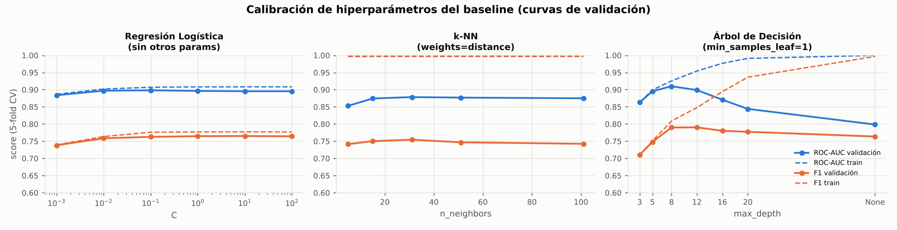

Qué muestran las curvas de validación:

* **Regresión logística:** prácticamente plana a partir de `C = 0.01`, con train y validación casi iguales (0.907 vs 0.898). Es un modelo de **alto sesgo**: la frontera lineal no captura las interacciones vistas en el EDA.
* **k-NN:** con `weights=distance` el score de train es 1.0 por construcción (cada punto es su propio vecino). En validación el óptimo está en k ≈ 31. Sufre con las ~100 dimensiones del one-hot (maldición de la dimensionalidad).
* **Árbol:** muestra el *trade-off* sesgo-varianza clásico. Hasta `max_depth = 8` mejoran train y validación. A partir de ahí train sigue subiendo hasta 1.0, mientras validación cae de 0.910 a 0.80 sin límite de profundidad (overfitting).

### Resultado: comparación con 5-fold CV

| modelo | ROC-AUC | F1 | accuracy | precision | recall | train ROC-AUC |
|:--|:--|:--|:--|:--|:--|--:|
| Dummy (clase mayoritaria) | 0.5000 ± 0.0000 | 0.0000 ± 0.0000 | 0.5829 | 0.0000 | 0.0000 | 0.500 |
| Regresión Logística (C=0.1) | 0.8982 ± 0.0055 | 0.7627 ± 0.0098 | 0.8148 | 0.8196 | 0.7134 | 0.907 |
| k-NN (k=31, distance) | 0.8784 ± 0.0110 | 0.7544 ± 0.0138 | 0.8068 | 0.8026 | 0.7117 | 1.000 |
| **Árbol de Decisión (depth=8)** | **0.9100 ± 0.0035** | **0.7901 ± 0.0061** | **0.8357** | **0.8459** | **0.7411** | 0.925 |

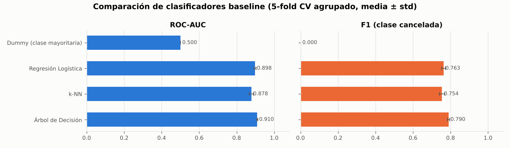

**Baseline elegido: Árbol de Decisión (`max_depth=8`).** Es el mejor en las dos métricas, con la menor varianza entre folds y una brecha train/validación chica (0.925 vs 0.910). Además es interpretable, lo que ayuda en el análisis de errores. Este es el punto de referencia que cada estrategia del Paso 4 tiene que superar: **ROC-AUC 0.910 / F1 0.790**.

Un patrón que aparece en los tres modelos: **la precision (≈ 0.82–0.85) es mayor que el recall (≈ 0.71–0.74)**. Con umbral 0.5, el modelo deja pasar más de una de cada cuatro cancelaciones (FN). Esto se analiza en el Paso 3.

---

## Paso 3 – Error analysis y enfoque data-centered

**Script:** `python steps/03_error_analysis.py` (~2.5 min) → `reports/tables/03_*`, `reports/figures/03_*`.

El análisis se hace sobre las **predicciones out-of-fold** del baseline (Árbol `max_depth=8`) en train. Cada reserva recibe la predicción de un modelo que no la vio al entrenar, así que los errores son representativos de lo que pasaría con datos nuevos, y el test sigue sin tocarse. Las métricas OOF globales coinciden con la CV: ROC-AUC 0.910 y F1 0.790.

### 3.1 Análisis de errores

#### Visión global: el modelo pierde cancelaciones (FN)

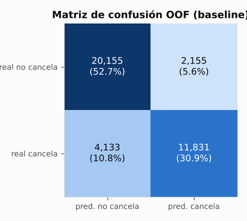 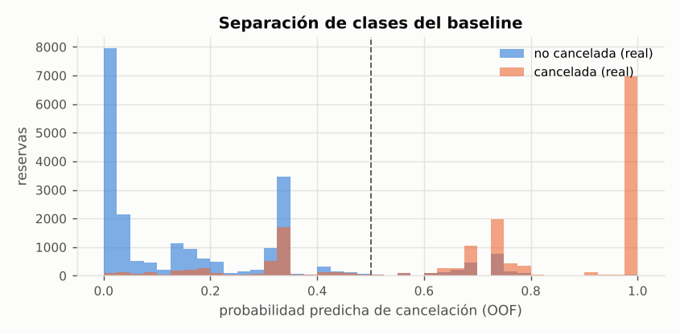

* Hay 6 288 errores sobre 38 274 reservas (16.4 %). **Dos tercios son falsos negativos** (4 133 cancelaciones no detectadas, FNR = 25.9 %) y un tercio falsos positivos (2 155, FPR = 9.7 %).
* Las cancelaciones con perfil "obvio" (locked_allocation, historial de cancelaciones, mucha anticipación) se predicen con probabilidad cercana a 1. En cambio, muchas cancelaciones reciben probabilidad baja: **1 138 FN tienen p < 0.2**. Son errores "confiados", que no se corrigen moviendo el umbral. Sólo 585 errores (9 %) caen en la zona dudosa 0.4–0.6.

#### Cohortes pedidas: `client_type`, `service_tier`, `reserved_gpu_type`

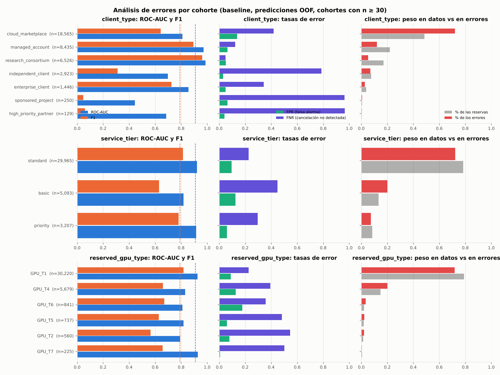

Cada fila es una cohorte. Columna izquierda: ROC-AUC y F1 del subgrupo (las líneas punteadas son los valores globales). Centro: tasas de falsos positivos y negativos. Derecha: qué parte de los datos y qué parte de los errores aporta la cohorte.

| cohorte | n | % datos | % errores | cancelación | ROC-AUC | F1 | FPR | FNR |
|:--|--:|--:|--:|--:|--:|--:|--:|--:|
| **client_type = cloud_marketplace** | 18 565 | 48.5 % | **72.1 %** | 37.9 % | **0.810** | **0.643** | 0.138 | 0.418 |
| client_type = managed_account | 8 435 | 22.0 % | 12.0 % | 43.3 % | 0.973 | 0.895 | 0.064 | 0.122 |
| client_type = research_consortium | 6 526 | 17.1 % | 5.2 % | 67.9 % | 0.988 | 0.963 | 0.052 | 0.049 |
| client_type = independent_client | 2 923 | 7.6 % | 6.9 % | 15.7 % | 0.697 | 0.310 | 0.030 | **0.786** |
| client_type = enterprise_client | 1 446 | 3.8 % | 2.7 % | 23.2 % | 0.856 | 0.725 | 0.048 | 0.342 |
| client_type = sponsored_project | 250 | 0.7 % | 0.7 % | 11.2 % | 0.444 | 0.047 | 0.063 | **0.964** |
| client_type = high_priority_partner | 129 | 0.3 % | 0.5 % | 22.5 % | 0.686 | 0.059 | 0.040 | **0.966** |
| service_tier = standard | 29 965 | 78.3 % | 72.3 % | 42.8 % | 0.921 | 0.813 | 0.096 | 0.226 |
| **service_tier = basic** | 5 093 | 13.3 % | **20.1 %** | 38.4 % | **0.819** | **0.630** | 0.124 | 0.448 |
| service_tier = priority | 3 207 | 8.4 % | 7.5 % | 37.1 % | 0.916 | 0.781 | 0.059 | 0.295 |
| reserved_gpu_type = GPU_T1 | 30 220 | 79.0 % | 71.8 % | 43.5 % | 0.926 | 0.818 | 0.090 | 0.227 |
| **reserved_gpu_type = GPU_T4** | 5 679 | 14.8 % | **20.0 %** | 35.3 % | **0.831** | **0.659** | 0.128 | 0.394 |
| reserved_gpu_type = GPU_T6 | 841 | 2.2 % | 3.3 % | 39.0 % | 0.811 | 0.670 | 0.177 | 0.357 |
| reserved_gpu_type = GPU_T5 | 737 | 1.9 % | 2.2 % | 31.2 % | 0.818 | 0.628 | 0.059 | 0.483 |
| reserved_gpu_type = GPU_T2 | 560 | 1.5 % | 2.1 % | 33.0 % | 0.794 | 0.564 | 0.077 | 0.546 |
| reserved_gpu_type = GPU_T7 | 225 | 0.6 % | 0.4 % | 24.0 % | 0.927 | 0.659 | 0.006 | 0.500 |

Lectura:

* **`client_type`** es la cohorte que más diferencia hace. `managed_account` y `research_consortium` son casi perfectos (AUC 0.97–0.99) porque buena parte de sus reservas son `locked_allocation`, que siempre se cancelan. **`cloud_marketplace` concentra el 72 % de los errores con sólo el 48 % de los datos**: AUC 0.81, y no detecta el 42 % de sus cancelaciones. Los clientes directos de baja cancelación (`independent_client`, `sponsored_project`, `high_priority_partner`) tienen un problema distinto. El modelo casi nunca predice "cancela" en ellos (tasa predicha 4–6 % contra una real de 11–23 %), así que su F1 cae a 0.05–0.31 con FNR de 0.79–0.97. Además su AUC es bajo (0.44–0.70), es decir que el modelo tampoco ordena bien dentro de esos grupos. Son pocos datos (≤ 3 000 filas) y no hay ninguna señal fuerte.
* **`service_tier`:** `basic` es el peor (AUC 0.82, F1 0.63) y aporta 20 % de los errores con 13 % de los datos. `standard` y `priority` quedan cerca del promedio.
* **`reserved_gpu_type`:** `GPU_T1` (79 % de los datos) está por encima del promedio. **Todos los demás tipos están peor** (AUC 0.79–0.83 y FNR 0.36–0.55). El árbol usa sus divisiones en el grupo mayoritario y los tipos minoritarios quedan sub-modelados.

#### Otros subgrupos relevantes

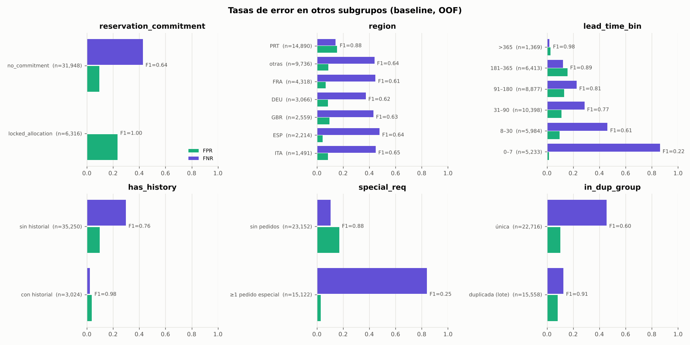

* **`reservation_commitment`:** 99.9 % de los errores ocurre en `no_commitment`. `locked_allocation` está resuelto (F1 = 1.00).
* **Anticipación (`hours_before_execution`):** las reservas con 0–7 h de anticipación cancelan poco (13 %), pero cuando cancelan el modelo no las detecta: **FNR = 0.86** y F1 = 0.22. Lo mismo ocurre con 8–30 h (FNR = 0.46).
* **Pedidos especiales:** con ≥ 1 pedido especial la FNR es **0.84**. El modelo aprendió que "pedido especial ⇒ no cancela" y falla en el 22 % que sí cancela.
* **Historial:** las reservas con historial previo son casi perfectas (F1 0.98), pero son sólo el 8 %. El 92 % sin historial tiene F1 0.76.
* **Reservas únicas vs. en lote:** las únicas tienen F1 0.60 y las duplicadas 0.91. Las reservas en lote siguen patrones fáciles (bloques cancelados en masa).

#### Falsos positivos y falsos negativos: ¿a quién se parecen?

Promedios por tipo de resultado (tabla `03_perfil_fp_fn`):

| variable | TP | **FN** | TN | **FP** |
|:--|--:|--:|--:|--:|
| n | 11 831 | **4 133** | 20 155 | **2 155** |
| prob. media predicha | 0.89 | 0.28 | 0.13 | 0.70 |
| hours_before_execution | 166 | **80** | 79 | **103** |
| special_resource_requests | 0.06 | **0.91** | 0.79 | **0.24** |
| % con pedidos especiales | 4.5 % | **67.6 %** | 56.8 % | **16.7 %** |
| % región PRT | 70.2 % | **33.4 %** | 21.8 % | **37.2 %** |
| % locked_allocation | 53.2 % | **0.0 %** | 0.1 % | 0.2 % |
| % cloud_marketplace | 34.6 % | **71.1 %** | 49.3 % | **74.0 %** |
| % broker_platform | 97.0 % | 86.6 % | 80.4 % | **94.4 %** |
| % en lote (duplicada) | 70.3 % | **29.0 %** | 27.5 % | 22.9 % |
| % con historial | 18.9 % | 1.4 % | 3.5 % | 1.3 % |

* **Los FN se parecen a los TN, no a los TP.** Son reservas de anticipación corta (80 h), con pedidos especiales (68 %), fuera de PRT, sin compromiso, sin historial y únicas. Todos los indicadores disponibles dicen "va a ejecutarse" y aun así se cancelan. Con las features actuales son prácticamente indistinguibles de las reservas completadas. Para detectarlas hace falta **información nueva** (3.4), no sólo un mejor modelo.
* **Los FP se parecen a los TP.** Son reservas de `cloud_marketplace` vía `broker_platform`, con anticipación relativamente larga y sin pedidos especiales: el perfil típico de quien cancela, que esta vez se ejecutó. Varios de estos casos (prob. media 0.70) están cerca del umbral y podrían corregirse con features más finas o con un modelo con más capacidad.

#### Regiones problemáticas del dataset

1. **Búsqueda de slices** (`03_slices_*`): se enumeraron todas las combinaciones de 1 y 2 variables con n ≥ 300 y se ordenaron por tasa de error y por cantidad de errores. La tasa de error global es 16.4 %.

| slice | n | tasa de error | FP | FN | % de errores |
|:--|--:|--:|--:|--:|--:|
| service_tier=basic & anticipación 8–30 h | 1 129 | **30.8 %** | 104 | 244 | 5.5 % |
| cloud_marketplace & anticipación 181–365 h | 2 389 | 29.4 % | 322 | 380 | 11.2 % |
| cloud_marketplace & región PRT | 2 629 | 28.5 % | 271 | 477 | 11.9 % |
| service_tier=basic & ≥ 1 pedido especial | 2 830 | 27.9 % | 48 | 741 | 12.5 % |
| **cloud_marketplace & no_commitment** | **18 546** | 24.4 % | 1 594 | 2 937 | **72.1 %** |

2. **Árbol "explicador" de errores:** un árbol de profundidad 3 entrenado para predecir *dónde* se equivoca el baseline (`03_arbol_errores.txt`) llega a las mismas regiones. La hoja `cloud_marketplace & hours_before_execution > 5.5 & single_experiment` tiene 15 057 reservas con 27 % de error. La hoja `no marketplace & no locked & región PRT` tiene 24 % de error.

**Conclusión de 3.1:** el resto del dataset (`locked_allocation`, clientes con historial, reservas en lote) está prácticamente resuelto (error 8.9 %). El problema del sistema es **una región grande y difícil: reservas sin compromiso hechas por `cloud_marketplace`**. Hay además subgrupos chicos con recall muy bajo: clientes directos, tier `basic`, GPUs que no son `T1` y reservas de último momento.

### 3.2 Curvas de aprendizaje

Se calcularon con `learning_curve` usando el mismo CV agrupado, del 10 % al 100 % del fold de entrenamiento (3 k a 30.6 k filas), para cuatro modelos de distinta capacidad:

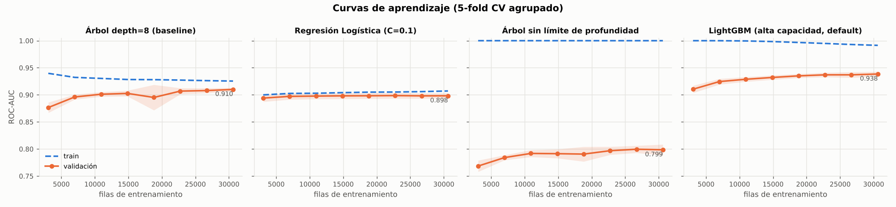

| modelo | ROC-AUC validación (3 k → 30.6 k filas) | brecha train–val final | diagnóstico |
|:--|:--|--:|:--|
| Árbol depth=8 (baseline) | 0.877 → **0.910**, plano desde ~23 k | 0.015 | **sesgo**: train baja y validación sube hasta encontrarse cerca de 0.91 |
| Regresión logística | 0.894 → 0.898, plano desde ~7 k | 0.009 | **sesgo puro**: el modelo lineal se satura con muy pocos datos |
| Árbol sin límite | 0.768 → 0.799 | 0.20 | **varianza**: memoriza el train |
| LightGBM (400 árboles, default) | 0.910 → **0.938**, todavía sube levemente | 0.053 | buen balance. Con 3 k filas ya iguala al baseline entrenado con 30 k |

**¿El sistema está limitado por el modelo o por los datos?** Por el **modelo**. Con el baseline, pasar de 15 k a 30 k filas mejora el AUC en +0.007. Cambiar a un modelo de mayor capacidad con los mismos datos mejora +0.028, y LightGBM con un décimo de los datos ya alcanza lo que el árbol logra con todos. El árbol de profundidad 8 y la regresión logística tienen curvas planas y juntas, la firma típica del alto sesgo. Agregarles datos no las mueve.

**¿Más datos mejorarían significativamente?** **Globalmente no.** Para el modelo de alta capacidad la curva sigue subiendo, pero lento: +0.0015 AUC entre 22.7 k y 30.6 k filas. Duplicar el dataset daría, extrapolando, del orden de +0.003–0.005, menos que lo que se gana eligiendo bien el modelo y las features. **La excepción es la cohorte foco** (3.3). Una curva de aprendizaje restringida a `cloud_marketplace & no_commitment` muestra que LightGBM sigue subiendo con pendiente clara (0.855 → 0.874 entre 7 k y 15 k filas), mientras el árbol se estanca en ~0.81:

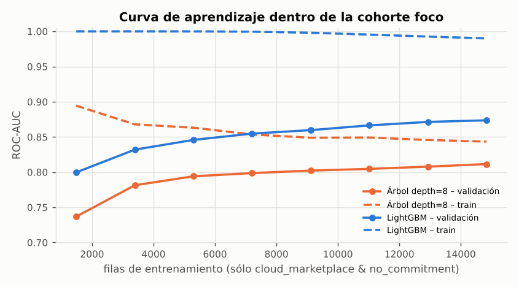

Más ejemplos *de esa cohorte* (y sobre todo más *información* sobre ella) sí ayudarían.

### 3.3 Estrategia data-centered: cohorte prioritaria

**Cohorte elegida: `client_type = cloud_marketplace` & `reservation_commitment = no_commitment`.**

| | cohorte foco | resto |
|:--|--:|--:|
| reservas (train) | 18 546 (**48.5 %**) | 19 728 |
| tasa de cancelación | 37.8 % (~7 000 cancelaciones) | 45.4 % |
| tasa de error del baseline | **24.4 %** | 8.9 % |
| % del total de errores | **72.1 %** | 27.9 % |
| ROC-AUC / F1 | **0.810 / 0.643** | 0.963 / 0.898 |
| precision / recall | 0.719 / **0.581** | 0.933 / 0.866 |

**Por qué es prioritaria:**

* **Frecuencia:** es la mitad de las reservas y casi tres de cada cuatro errores. Ninguna otra intervención tiene tanto margen. El resto del dataset ya tiene F1 ≈ 0.90, así que **cualquier mejora global del sistema tiene que salir de acá**.
* **Impacto operativo:** son reservas *sin compromiso contractual*, así que si se cancelan la plataforma no cobra penalidad y la capacidad GPU bloqueada queda ociosa sin compensación. Con recall 0.58 se pierde de vista el 42 % de esas cancelaciones (unas 2 900 en train), es decir capacidad que podría re-asignarse u ofrecerse en sobre-reserva. Los FP (~1 600) también cuestan: si se sobre-vende capacidad en base a una cancelación que no ocurre, hay clientes que llegan y no tienen GPU (penalidades de SLA y daño reputacional). Por ser el canal de marketplace, además, es el segmento más sensible a la competencia.
* **Posibles causas del mal rendimiento:**
  1. **Ausencia de las señales fuertes:** dentro de la cohorte, las dos variables más predictivas del dataset son constantes. El compromiso siempre es `no_commitment` y el 98 % no tiene historial. El modelo tiene que apoyarse en señales débiles (anticipación, región, pedidos especiales, costo).
  2. **Capacidad del modelo:** el árbol de profundidad 8 usa gran parte de sus divisiones en separar las cohortes fáciles y le queda poca profundidad para las interacciones dentro de esta cohorte (región × anticipación, costo × tipo de GPU, etc.). La curva de aprendizaje de la cohorte confirma que un modelo de más capacidad sí extrae más señal.
  3. **Ruido intrínseco / información faltante:** los FN de esta cohorte tienen perfiles idénticos a reservas completadas (3.1). Probablemente cancelan por factores externos (cambios de precio en el marketplace, cambios en el proyecto del cliente, ofertas de la competencia) que no están en los datos.
  4. **Anonimato del canal:** es la cohorte con más reservas únicas (no en lote) y sin `organization_id`, así que no hay forma de reconocer al cliente entre reservas.
* **Siguientes pasos propuestos** (los primeros se implementan en el Paso 4):
  1. **Modelos de mayor capacidad** (boosting, ensambles) que capturen interacciones dentro de la cohorte.
  2. **Feature engineering dirigido:** costo relativo al precio típico del mismo tipo de GPU y período (el cliente de marketplace compara precios), costo total de la reserva, día de la semana, interacciones de anticipación con región, *target encoding* del agente/broker (cada broker tiene políticas de cancelación distintas), ratio de cancelaciones previas.
  3. **Tratamiento del desbalance / umbral:** la cohorte tiene recall bajo. Ajustar el umbral de decisión o usar `class_weight` puede mejorar el F1.
  4. **Pesos por cohorte** o un modelo específico para la cohorte si un modelo global no alcanza.
  5. **Adquisición de datos** (3.4) para los FN "confiados" que ningún modelo va a poder separar con las features actuales.

### 3.4 Adquisición de datos

Qué datos adicionales incorporaríamos, en orden de prioridad, y por qué esperamos que mejoren el sistema:

| # | dato a adquirir | por qué debería mejorar el sistema | evidencia en nuestro análisis |
|:--|:--|:--|:--|
| 1 | **Identificador persistente del cliente en el marketplace y su historial completo** (cancelaciones y ejecuciones previas por cuenta, aunque reserve vía broker) | El historial es la señal más fuerte del dataset, pero hoy el 92 % de las reservas no lo tiene porque el cliente de marketplace es anónimo | Con historial: F1 0.98. Sin historial: F1 0.76. `previous_job_cancellations = 1` ⇒ 96 % de cancelación |
| 2 | **Señales de "preparación" del workload** entre la reserva y la ejecución: datasets subidos, imagen/contenedor construido, repo vinculado, tests de quota | Son indicadores adelantados de que el workload realmente va a correr. Atacan los FN "confiados", que tienen un perfil estático igual al de los que completan | 1 138 FN con p < 0.2: las features estáticas no los separan |
| 3 | **Dinámica de precios:** precio vigente al momento de reservar vs precio actual del mismo recurso, índice de precios de la competencia / spot | En marketplace, una baja de precio posterior incentiva a cancelar y re-reservar más barato. Hoy sólo tenemos el costo pactado | `estimated_cost_per_hour` no tiene relación marginal con la cancelación, pero lo relevante es el precio *relativo*, que hoy no podemos medir |
| 4 | **Política de cancelación y pagos:** ventana de cancelación gratuita del broker, si hay pago anticipado o método de pago registrado, depósito | `no_commitment` agrupa situaciones muy distintas. Saber cuánto le cuesta cancelar a cada cliente permitiría segmentar la cohorte foco | `reservation_commitment` es la variable más fuerte, pero es binaria en la práctica |
| 5 | **Fecha y hora de creación y log de modificaciones** (no sólo el conteo) | Permite features como "días desde la última modificación" o "reserva creada en fin de semana o fuera de horario", y evita el leakage temporal de `assigned_gpu_type` | `resource_modifications ≥ 1` reduce la cancelación a 15–25 %, pero no sabemos *cuándo* ocurrieron |
| 6 | **Más ejemplos etiquetados de la cohorte foco** (por ejemplo, más períodos históricos) | La curva de aprendizaje de la cohorte sigue subiendo con el modelo de alta capacidad | +0.019 AUC entre 7 k y 15 k filas de la cohorte |

Los puntos 1–4 agregan **información nueva**, lo cual vale más que agregar más filas del mismo tipo: la curva de aprendizaje global (3.2) muestra que más filas con las mismas columnas aportan poco, mientras que el análisis de FN muestra errores que ninguna combinación de las columnas actuales puede separar.
