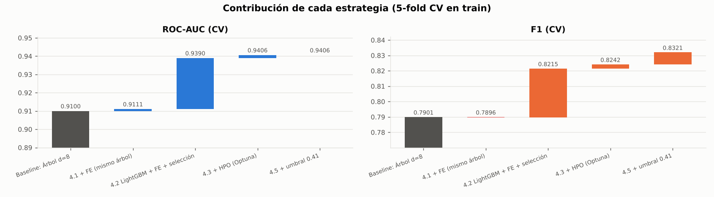

# TP3 – Resumen (Grupo 12)

Versión corta del [README.md](README.md). Cada sección dice qué se hizo, qué salió y en qué parte del informe completo está el detalle (§ = sección del README).

**Problema:** predecir si una reserva de GPU se va a cancelar (`canceled_job`), con 47 842 reservas y 41.7 % de cancelaciones.

## Resultado final (test, nunca usado antes del Paso 5)

| | Baseline (Árbol de decisión, depth 8) | **Final** (LightGBM tuneado + FE + umbral 0.41) | Δ (IC 95 %) |
|:--|--:|--:|:--|
| ROC-AUC | 0.916 | **0.946** | +0.030 [+0.023, +0.037] |
| F1 (clase cancelada) | 0.795 | **0.836** | +0.040 [+0.027, +0.058] |
| Recall | 0.746 | **0.856** | +0.110 |
| Precision | 0.852 | 0.817 | −0.036 |

El modelo final comete 188 errores menos (−12 %): detecta 11 puntos más de cancelaciones a cambio de 3.6 puntos de precision.

---

## Paso 1 – Datos y preprocesamiento → [README Paso 1](README.md#paso-1--preprocesamiento-y-análisis-exploratorio)

- **Leakage (§1.2):** se eliminan `execution_status` (es el target re-codificado) y `execution_status_date` (fecha de cancelación o de finalización). Las dos se conocen recién **después** de lo que queremos predecir.
- **Duplicados (§1.1, §1.3):** el 33 % de las filas son copias exactas (reservas en lote) y cancelan mucho más (61 % vs 28 %). **No se borran**, pero el split train/test (80/20) y la CV están **agrupados**, para que las copias de una reserva nunca queden de los dos lados.
- **Limpieza (§1.4):** las categóricas faltantes pasan a `"missing"`; los IDs de agente y organización se tratan como categorías, con `"none"` = sin agente u organización; los numéricos faltantes se imputan con la mediana. El one-hot agrupa los *valores* raros en una columna `infrequent`. **No borra columnas.**
- **Hallazgos del EDA (§1.5):**

| señal | tasa de cancelación |
|:--|:--|
| `locked_allocation` | ≈ 100 % (contra 30 % sin compromiso). Es la variable más fuerte |
| región PRT | 65 % (resto de Europa: 17–30 %) |
| `research_consortium` | 68 % |
| anticipación ≤ 4 h → > 276 h | 12 % → 72 % |
| sin pedidos especiales → con alguno | 55 % → ~20 % |
| exactamente 1 cancelación previa | 96 % |

## Paso 2 – Baseline, validación y métricas → [README Paso 2](README.md#paso-2--model-centered-ml-baseline-validación-cruzada-y-métricas)

- **CV (§2.2):** 5-fold estratificado y agrupado por duplicados, sólo en train. Todo el preprocesamiento va dentro del `Pipeline` y se usan los mismos folds para todos los experimentos.
- **Métricas (§2.3):**
  - **ROC-AUC:** mide si el modelo ordena bien el riesgo y no depende del umbral. Es el criterio para elegir hiperparámetros.
  - **F1 de la clase cancelada:** mide las decisiones finales y balancea falsas alarmas contra cancelaciones perdidas. La accuracy no sirve sola: predecir siempre "no cancela" ya da 58 %.
- **Baseline (§2.1):**

| modelo | ROC-AUC | F1 |
|:--|--:|--:|
| **Árbol de decisión (depth 8)** | **0.910** | **0.790** |
| Regresión logística | 0.898 | 0.763 |
| k-NN | 0.878 | 0.754 |

  Se eligió el árbol.

## Paso 3 – Análisis de errores → [README Paso 3](README.md#paso-3--error-analysis-y-enfoque-data-centered)

- **Errores (§3.1):** 2/3 de los errores son **falsos negativos** (cancelaciones no detectadas). Por cohorte:

| cohorte | qué pasa |
|:--|:--|
| `cloud_marketplace` | **48 % de los datos y 72 % de los errores** (AUC 0.81, F1 0.64) |
| `independent_client` | recall muy bajo (FNR 0.79) |
| tier `basic` | peor que el promedio |
| GPUs que no son `GPU_T1` | peor que el promedio |

- **FN vs FP:** los FN *se parecen a reservas que se completan* (anticipación corta, pedidos especiales, sin historial). Con los datos actuales son casi indistinguibles. Los FP se parecen a los cancelados típicos.
- **Curvas de aprendizaje (§3.2):** el sistema está **limitado por el modelo, no por los datos**. LightGBM con 3 000 filas ya iguala al árbol entrenado con 30 000. Más filas casi no ayudan en general, salvo dentro de la cohorte problemática.
- **Cohorte prioritaria (§3.3):** `cloud_marketplace & no_commitment`.
  - Frecuencia: 48.5 % de las reservas.
  - Rendimiento: error 24 % (vs 9 % en el resto), recall 0.58.
  - Impacto: son reservas sin penalidad por cancelar, así que la capacidad perdida queda ociosa.
  - Causas: le faltan las señales fuertes (compromiso, historial) y el árbol tiene poca capacidad.
- **Datos a adquirir (§3.4):** historial del cliente en el marketplace, señales de preparación del workload (datos subidos, contenedor listo), dinámica de precios, política de cancelación y pagos, fecha de creación y log de modificaciones.

## Paso 4 – Optimización (5 estrategias) → [README Paso 4](README.md#paso-4--optimización-del-sistema-de-ml)

| estrategia | resultado (CV) | ¿se adopta? |
|:--|:--|:--|
| **4.1 Feature engineering + selección** | +0.010 AUC en regresión logística, ~0 en LightGBM. Se pasa de 49 a 30 variables sin pérdida | sí |
| **4.2 Model selection** (11 familias) | LightGBM 0.939 / 0.822: **+0.029 AUC, +0.031 F1**. Es la mayor mejora | sí |
| **4.3 Hiperparámetros** (Random Search vs Optuna TPE) | +0.002 AUC (mejora en 5/5 folds). TPE explora mejor: 75 % de sus trials superan al modelo sin tunear, contra 15 % en Random Search | sí (TPE) |
| **4.4 Ensambles** (voting, stacking, bagging) | +0.0007 AUC: los modelos se equivocan en las mismas reservas (correlación de errores 0.82–0.88) | no |
| **4.5 Data-centered** | **umbral 0.41: +0.008 F1** (recall 0.80 → 0.85). Class weight, deduplicar, quitar anomalías y pesar la cohorte: sin mejora | sólo el umbral |

## Paso 5 – Modelo final → [README Paso 5](README.md#paso-5--modelo-final-y-función-predictora)

- **Modelo (§5.1):** LightGBM (381 árboles, hiperparámetros de Optuna) + FE + target encoding + 30 variables, con umbral 0.41.
- **CV vs test (§5.2, §5.3):** AUC 0.941 vs 0.946 y F1 0.832 vs 0.836. Son consistentes, así que no hay sobreajuste de la CV.
- **Performance esperada:** AUC ≈ 0.94–0.95 y F1 ≈ 0.83–0.84 en reservas nuevas. Si el set de evaluación comparte reservas duplicadas con nuestro dataset, va a dar más (≈ 0.958 / 0.864).
- **Qué más ayudó (§5.4):** cambiar de modelo explica ~85 % de la mejora en AUC; después vienen el umbral (en F1) y el tuning.



- **¿Global o por subgrupos? (§5.5):** ninguna cohorte empeora, pero la mejora se concentra donde estaban los errores:

| cohorte | cambio en test |
|:--|:--|
| `cloud_marketplace & no_commitment` | F1 0.645 → **0.736**; ahí está el 61 % de los errores evitados |
| `independent_client` | +0.26 F1 |
| reservas con 0–7 h de anticipación | +0.26 F1 |
| cohortes que ya andaban bien (`locked_allocation`, `research_consortium`) | casi sin cambio |

## Paso 6 – Predictor → [README Paso 6](README.md#paso-6--predictor-autocontenido-para-la-entrega)

- [`predictor/predictor_v1_Grupo_12.py`](predictor/predictor_v1_Grupo_12.py): **un solo archivo** que **sólo necesita `numpy` y `pandas`**. Incluye el modelo y todos los parámetros aprendidos.
- `predictor_v1_Grupo_12(X)` recibe un DataFrame y devuelve un `np.ndarray` de 0/1.
- Verificado: da las mismas 47 842 predicciones que el pipeline original. Además se probó en una carpeta nueva, sin sklearn ni lightgbm.

```python
from predictor_v1_Grupo_12 import predictor_v1_Grupo_12
y_pred = predictor_v1_Grupo_12(X)   # X = DataFrame con las columnas del CSV
```

---

## Mensajes clave

1. **Evaluación honesta:** se quitaron las columnas con leakage y el split está agrupado por duplicados.
2. **El error estaba concentrado:** una cohorte (marketplace sin compromiso) tenía el 72 % de los errores, casi todos falsos negativos.
3. **El cuello de botella era el modelo:** pasar del árbol a boosting dio la mayor mejora. Tuning y umbral aportaron ajustes finos, y los ensambles no aportaron.
4. **Resultado:** test AUC 0.946 y F1 0.836 (baseline: 0.916 / 0.795). La mejora es significativa y se concentra en la cohorte problemática.
5. **Para cerrar la brecha restante hacen falta datos nuevos** (historial del cliente, señales de preparación, precios), no otro modelo.
